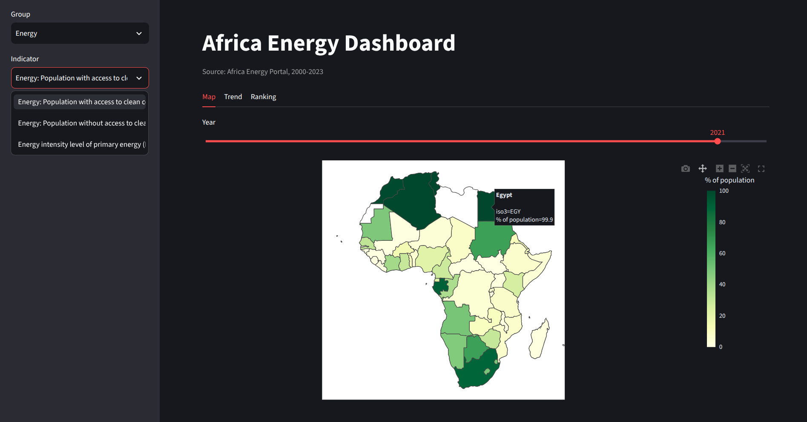
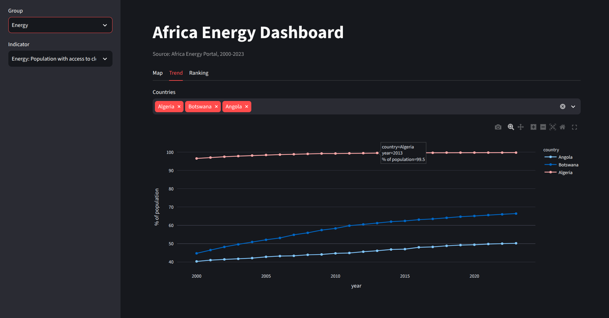
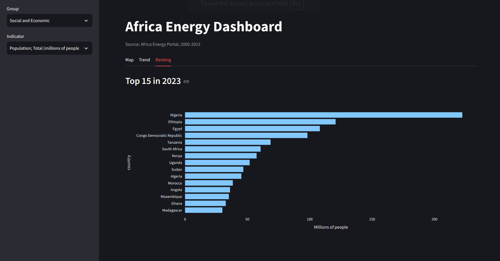

# Africa Energy Data Pipeline

Pulls energy, electricity and socio-economic indicators for all 54 African countries (2000-2023) from the
[Africa Energy Portal](https://africa-energy-portal.org/), cleans them into one tidy table, stores them in
MongoDB, and serves them through a REST API and a small dashboard.

```
Portal API  ->  extract (raw JSON)  ->  transform (tidy CSV)  ->  MongoDB  ->  FastAPI  ->  Streamlit
```



| Trend | Ranking |
| --- | --- |
|  |  |

## What it does

- **Extract:** the portal's database page is a front end for one JSON endpoint (`POST /get-database-data`).
  The pipeline calls it directly, 7 requests in total (one per indicator topic, all years at once), and saves
  each response as raw JSON under `data/raw/`. Re-running skips what is already downloaded.
- **Transform:** flattens the raw JSON into one row per country, indicator and year (53,136 rows, 41 indicators),
  converts country codes to ISO3, and prints a validation report. Missing values stay `null`; they are not
  turned into zeros.
- **Load:** upserts into MongoDB on a unique key `(iso3, group, indicator, year)`, so loading twice never
  creates duplicates.
- **Serve:** a FastAPI service and a Streamlit dashboard (map, trend and ranking views) read from MongoDB.

Indicator groups: Electricity (access, supply, installed capacity), Energy (clean cooking access, energy
intensity) and Social and Economic (GDP, population).

## Quick start

Requires [uv](https://docs.astral.sh/uv/) and Docker (Docker is only used to run MongoDB).

```bash
uv sync
cp .env.example .env
docker compose up -d mongo

uv run africa-energy probe       # optional: sends two small requests and prints a sample record
uv run africa-energy extract     # download raw JSON to data/raw/
uv run africa-energy transform   # write data/processed/energy_long.csv
uv run africa-energy load        # upsert into MongoDB

uv run uvicorn africa_energy_extraction.api:app --reload                     # http://localhost:8000/docs
uv run streamlit run src/africa_energy_extraction/dashboard.py               # http://localhost:8501
```

If extraction reports `BLOCKED` (the portal sits behind Cloudflare), open the portal in your browser, copy the
`Cookie` and `User-Agent` request headers from DevTools into `AEP_COOKIE` and `AEP_USER_AGENT` in `.env`, and run
it again. It is not needed otherwise.

## API

| Endpoint | Description |
| --- | --- |
| `GET /health` | MongoDB connectivity and document count |
| `GET /indicators` | Groups, topics, indicator names and units |
| `GET /countries` | ISO3 code, country name, region |
| `GET /timeseries?indicator=...&countries=KEN,UGA&start=2010&end=2023` | Values over time |
| `GET /latest?indicator=...&year=2022&limit=10` | Ranked snapshot of countries for one year |

Indicator names must match exactly; list them with `/indicators`.

## Data model

One document per country, indicator and year:

```json
{
  "iso3": "KEN",
  "country": "Kenya",
  "region": "East Africa",
  "group": "Electricity",
  "topic": "Access",
  "indicator": "Population access to electricity-National (% of population)",
  "unit": "% of population",
  "source": null,
  "year": 2023,
  "value": 76.5
}
```

## Project layout

```
src/africa_energy_extraction/
  catalog.py     indicator catalog and country list
  client.py      HTTP client (retries, Cloudflare detection)
  extract.py     resumable download to data/raw/
  transform.py   raw JSON -> tidy CSV, validation
  load.py        CSV -> MongoDB upsert
  api.py         FastAPI app
  dashboard.py   Streamlit app
  cli.py         the `africa-energy` command
tests/           pytest suite (no network or database needed)
```

Run the tests with `uv run pytest`.

## Notes on the data

- Many series are `0` in every year (for example nuclear or geothermal capacity in countries that have none).
  The portal may also use `0` where data is unavailable, so check an indicator before treating a zero as real.
  The transform report counts these series.
- Country names follow the portal's spelling (for example `Guinea Bissau`, `Congo Democratic Republic`).
- Data belongs to the Africa Energy Portal and its upstream sources (each row carries a `source` field).
  This repository contains code only; run `extract` to download the data yourself, and check the portal's terms
  before redistributing it.

## History

The first version of this project used Playwright to click through the portal and download spreadsheets
(2000-2022). It is preserved at the [`v1.0.0`](../../tree/v1.0.0) tag.

## License

MIT